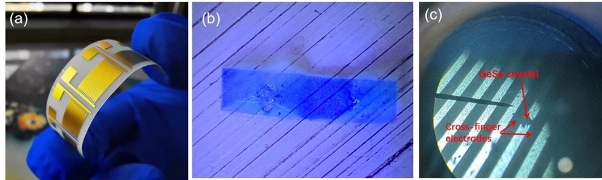
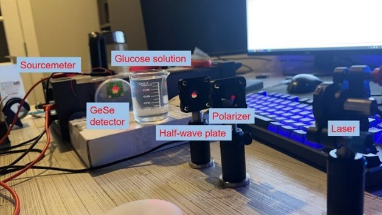
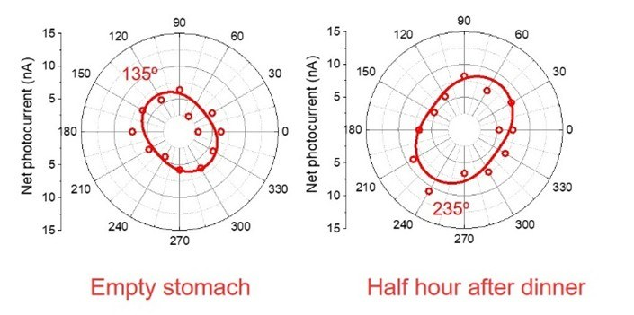

# GeSe-Based Non-Invasive Glucose Biosensor

**Flexible nanomaterial sensor for optical glucose detection using polarimetry and machine learning**

[](https://doi.org/10.54254/2755-2721/72/20240981)
[](https://doi.org/10.1016/j.biosx.2025.100725)
[]()
<!-- TODO: add verified Google Patents or USPTO public document URL for application 19/203,391. No public page was found as of 2026-11-10. -->

## Overview

This project develops a flexible GeSe nanomaterial biosensor for non-invasive glucose sensing. The work is at the laboratory stage (third-generation lab prototype). The sensor uses **germanium selenide (GeSe) nanomaterial photodetectors** to measure glucose concentration through optical polarimetry, with machine learning algorithms for calibration.

## Key Results

| Metric | Value |
|--------|-------|
| Coefficient of Determination (R²) | **0.94** (lab benchmark) |
| Mean Absolute Error (MAE) | **≈ 8.6 mg/dL** (lab benchmark) |
| Localization Method | Optical Polarimetry |
| ML Calibration | Supervised regression model |

## Methodology

### Sensing Principle
Glucose in biological fluids rotates the plane of polarized light. The GeSe photodetector measures this rotation with high sensitivity due to the material's anisotropic optical properties.

### Evolution of the Platform
1. **Generation 1:** Flexible GeSe nanomaterial sensor with conventional polarimetric detection and ML calibration
2. **Generation 2:** Polarizer-free architecture exploiting in-plane anisotropy of 2D GeSe for chiroptical biosensing, enabling a more compact wearable form factor
3. **Generation 3:** Third-generation lab prototype

### Machine Learning Pipeline
- Feature extraction from raw optical signals
- Supervised regression for glucose concentration prediction

## Figures

Photographs and diagrams below are from [maxkopptech.com/glucose-monitoring](https://maxkopptech.com/glucose-monitoring/) and the site’s [Glucose Monitoring gallery](https://maxkopptech.com/pgc_simply_gallery/glucose-monitoring/). Captions describe only what is visible in each image. The work remains at the laboratory stage; the fingertip photographs are noninvasive self-tests, not a clinical study.


*Schematic of the laboratory optical train, labeled on the figure: 632 nm laser, polarizer, half-wave plate, glucose solution, and GeSe photodetector.*



*Laboratory photographs labeled (a) a flexible gold electrode array, (b) a film on a substrate, and (c) a microscope view marked “GeSe crystal” and “Cross-finger electrodes.”*


*(a) A small interdigitated electrode device on tape. (b) A fingertip holding a small flexible sensor. Laboratory / self-test photographs; noninvasive fingertip use.*



*Labeled laboratory bench: sourcemeter, GeSe detector, a beaker marked “Glucose solution,” half-wave plate, polarizer, and laser.*


*Photograph of a noninvasive fingertip self-test in the laboratory, labeled “Fingers,” “Incident laser,” and “GeSe detector.”*



*Polar plots of net photocurrent (nA) versus angle, labeled “Empty stomach” (135° marked) and “Half hour after dinner” (235° marked). Axes run to 15 nA. The figure does not report R² or MAE.*


*Three-panel photograph of a portable enclosure being assembled, with optical mounts and a small circuit board inside a black box. Also appears on the glucose-monitoring page and /new-home/.*


*A finger placed in the slot of a black boxed laboratory prototype that also has a barrel power connector. Laboratory / self-test photograph.*

## Publications

1. M. B. Kopp, "Flexible nanomaterial sensors for non-invasive health monitoring," *Applied and Computational Engineering*, vol. 72, pp. 45–58, 2024. [doi:10.54254/2755-2721/72/20240981](https://doi.org/10.54254/2755-2721/72/20240981)

2. M. B. Kopp, "Next-generation polarimetric biosensors: machine learning–driven GeSe photodetectors for noninvasive glucose monitoring," *Biosensors and Bioelectronics: X*, vol. 28, art. 100725, 2025 (sole author, open access). [doi:10.1016/j.biosx.2025.100725](https://doi.org/10.1016/j.biosx.2025.100725)

3. M. B. Kopp, "Exploiting In-Plane Anisotropy of 2D GeSe for Polarizer-Free Chiroptical Biosensing: Machine Learning-Enhanced Wearable Glycemic Diagnostics." *(in preparation)*

## Awards

- **S.T. Yau High School Science Award** — Bronze Medal, Physics (North America), 2024
- **NJSHS National Symposium** — 3rd Place Poster Award (Dept. of Defense), 2024

## Tools & Technologies

- **Simulation:** COMSOL Multiphysics (optical modeling)
- **Data Analysis:** Python, MATLAB
- **Fabrication:** Nanomaterial synthesis, flexible substrate processing
- **ML Frameworks:** scikit-learn, custom calibration pipelines

## Repository Structure

```
gese-glucose-biosensor/
├── figures/            # Laboratory photographs, optical-train schematic, and result plot
├── src/
├── README.md
├── requirements.txt
└── LICENSE
```

## License

This project is licensed under the MIT License. See [LICENSE](LICENSE) for details.

## Contact

**Maximilian Kopp** — [maxkopp2007@gmail.com](mailto:maxkopp2007@gmail.com) | [maxkopptech.com](https://www.maxkopptech.com) | [ORCID](https://orcid.org/0009-0008-6431-8137) | [Google Scholar](https://scholar.google.com/citations?user=TrKuDMsAAAAJ) | [LinkedIn](https://www.linkedin.com/in/maxkopp)
