# GeSe-Based Non-Invasive Glucose Biosensor

**Flexible nanomaterial sensor for optical glucose detection using polarimetry and machine learning**

[](https://doi.org/10.54254/2755-2721/72/20240981)
[](https://doi.org/10.1016/j.biosx.2025.100725)
[]()
<!-- TODO: add verified Google Patents or USPTO public document URL for application 19/203,391. No public page was found as of 2026-11-10. -->

## Overview

This project develops a flexible GeSe nanomaterial biosensor for non-invasive glucose sensing. The work is at the laboratory stage (third-generation lab prototype). The sensor uses **germanium selenide (GeSe) nanomaterial photodetectors** to measure glucose concentration through optical polarimetry, with machine learning algorithms for calibration.

## Key Results

The values below are taken from the author's S.T. Yau High School Science Award research report (16 August 2024), which is the primary source for this repository's numbers, and from the two subsequent papers. The work is at the laboratory stage. The fingertip measurement is a noninvasive self-test by the author, not a clinical study.

### Yau 2024 research report

Kopp, M. B., *Analysis of the Polarized Photo Response of GeSe and Its Application in Non-invasive Blood Glucose Monitoring*, S.T. Yau High School Science Award research report, 16 August 2024.

| Quantity | Value | Source in the report |
|----------|-------|----------------------|
| Photoresponsivity at 1 V | 0.15 mA/W | §4.1, p. 8 |
| External quantum efficiency | 0.028% | §4.1, p. 8 |
| Angle of photocurrent maximum | 150° (zigzag axis) | §4.1, p. 8 |
| Glucose-solution range | 36–180 mg/dL, then extended to 1080 mg/dL | §4.2, pp. 9–11 |
| Detection sensitivity | 1.59° (mg/dL)⁻¹ | §4.2 and conclusion, pp. 10, 18 |
| Fingertip self-test rotation | 100° (empty stomach vs half an hour after food) | §4.4, p. 16 |
| Inferred glucose increase | 62.9 mg/dL (= 100 / 1.59, as stated) | §4.4, p. 16 |
| Gradient-descent loss (n = 1, α = 0.04) | stabilizes at 2.6463 around step 250 | §4.3.2, p. 14 |
| Gradient-descent loss (n = 2, α = 0.04) | stabilizes at 0.00069203 around step 200 | §4.3.2, p. 15 |

Figure 21 is labeled 135° (“Empty stomach”) and 235° (“Half hour after dinner”); 235 − 135 = 100°, which matches the text. A compact diagnostic kit is shown in Figures 22–23.

### ACE 2024

Kopp, M. B., *Applied and Computational Engineering* 72, 45–58 (2024). [doi:10.54254/2755-2721/72/20240981](https://doi.org/10.54254/2755-2721/72/20240981)

The ACE article reports the same detection sensitivity of 1.59° (mg/dL)⁻¹, the same 36–180 mg/dL and 1080 mg/dL solution ranges, and the same 100° / 62.9 mg/dL fingertip self-test.

### B&B:X 2025

Kopp, M. B., *Biosensors and Bioelectronics: X* 28, 100725 (2025). [doi:10.1016/j.biosx.2025.100725](https://doi.org/10.1016/j.biosx.2025.100725)

From the published abstract:

| Quantity | Value |
|----------|-------|
| In-vitro range | 50–300 mg/dL |
| Linear phase sensitivity | 1.59 × 10⁻² ° (mg dL⁻¹)⁻¹ |
| Detection limit | ≈12 mg/dL |
| In-vitro R² | 0.96 |
| Fingertip vs glucometer R² | 0.91 |
| Gradient-boosting improvement | >20% |
| MAE | 8.6 mg/dL |
| RMSE | 11.2 mg/dL |

The abstract describes the fingertip comparison as preliminary reflectance measurements versus glucometer readings.

## Methodology

### Sensing Principle
Glucose in biological fluids rotates the plane of polarized light. The GeSe photodetector measures this rotation with high sensitivity due to the material's anisotropic optical properties.

### Evolution of the Platform
1. **Generation 1:** Flexible GeSe nanomaterial sensor with conventional polarimetric detection and ML calibration
2. **Generation 2:** Polarizer-free architecture exploiting in-plane anisotropy of 2D GeSe for chiroptical biosensing, enabling a more compact wearable form factor
3. **Generation 3:** Third-generation lab prototype

### Machine Learning Pipeline
- Feature extraction from raw optical signals
- Supervised regression for glucose concentration prediction

### Methods summary (from the Yau 2024 report)

Fabrication and optical measurements follow the Yau research report, §§3–4.

- GeSe flakes were mechanically exfoliated from HQ Graphene single crystals with Nitto tape and transferred onto a flexible PET substrate with pre-defined cross-finger gold electrodes (60 μm spacing) by a PDMS-assisted dry-transfer process, then heated at 60 °C for 5 minutes.
- Current–voltage curves were taken with a Keithley 2450 source meter in an optical darkroom at room temperature. Figure 8 compares dark conditions with 5 mW laser irradiation. Section 4.1 reports a photoresponsivity of 0.15 mA/W at 1 V and an external quantum efficiency of 0.028%.
- The report text in §3.2 describes a 658 nm laser (§2.2 also uses “658 nm equals to 1.88 eV”). Figure 6 of the report is labeled “632nm laser.”
- For glucose solutions, the laser passed through the solution before reaching the detector. Photocurrent was recorded at 1 V bias while a half-wave plate was rotated so that the polarization angle ran from 0° to 180°. Polarization angle was obtained by fitting a sinusoid (equation 10 in the report).
- First-principles calculations of GeSe optical anisotropy were performed with VASP (PBE GGA, PAW, a 1×1 cell of four GeSe layers, 30 Å vacuum, 8×8×1 k-points, 400 eV cutoff).
- Machine-learning comparisons used the normal equation and gradient descent at polynomial orders n = 1 and n = 2 (learning rate α = 0.04).
- For the fingertip self-test, the laser irradiated the author’s finger and the GeSe detector collected reflected and scattered light (§4.4). A portable diagnostic kit is shown in Figures 22–23.


## Figures

Photographs and diagrams below are from [maxkopptech.com/glucose-monitoring](https://maxkopptech.com/glucose-monitoring/) and the site’s [Glucose Monitoring gallery](https://maxkopptech.com/pgc_simply_gallery/glucose-monitoring/). Captions describe only what is visible in each image. The work remains at the laboratory stage; the fingertip photographs are noninvasive self-tests, not a clinical study.

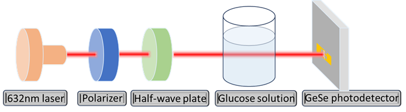

*Schematic of the laboratory optical train, labeled on the figure: 632 nm laser, polarizer, half-wave plate, glucose solution, and GeSe photodetector.*


*Laboratory photographs labeled (a) a flexible gold electrode array, (b) a film on a substrate, and (c) a microscope view marked “GeSe crystal” and “Cross-finger electrodes.”*

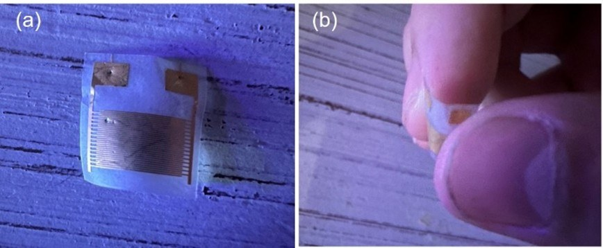

*(a) A small interdigitated electrode device on tape. (b) A fingertip holding a small flexible sensor. Laboratory / self-test photographs; noninvasive fingertip use.*


*Labeled laboratory bench: sourcemeter, GeSe detector, a beaker marked “Glucose solution,” half-wave plate, polarizer, and laser.*

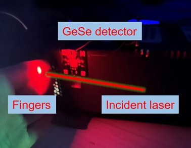

*Photograph of a noninvasive fingertip self-test in the laboratory, labeled “Fingers,” “Incident laser,” and “GeSe detector.”*


*Polar plots of net photocurrent (nA) versus angle, labeled “Empty stomach” (135° marked) and “Half hour after dinner” (235° marked). Axes run to 15 nA. The figure does not report R² or MAE.*

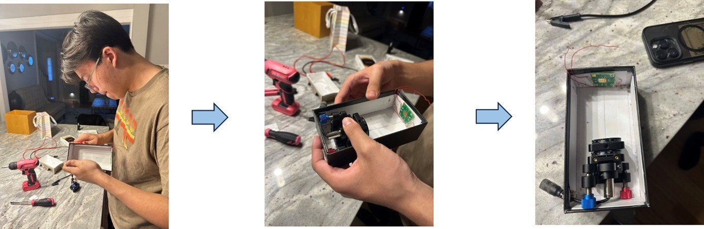

*Three-panel photograph of a portable enclosure being assembled, with optical mounts and a small circuit board inside a black box. Also appears on the glucose-monitoring page and /new-home/.*

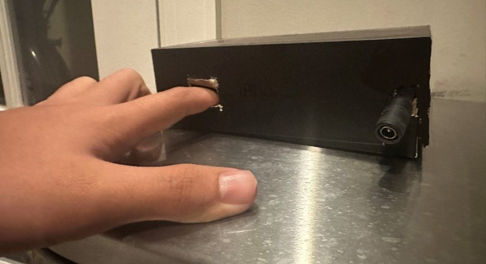

*A finger placed in the slot of a black boxed laboratory prototype that also has a barrel power connector. Laboratory / self-test photograph.*

## Figures from the Yau 2024 research report

The photographs in the previous section are from the author’s site. The figures below are taken from the S.T. Yau High School Science Award research report (16 August 2024). Full captions are in [`figures/paper/README.md`](figures/paper/README.md).

*From Kopp, M. B. (16 August 2024). Analysis of the Polarized Photo Response of GeSe and Its Application in Non-invasive Blood Glucose Monitoring. S.T. Yau High School Science Award research report, Germantown Academy.*

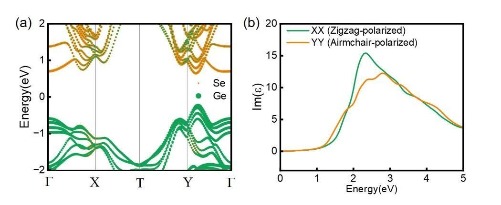

*Yau Figure 4 (p. 5): First-principles calculation of GeSe multilayers. (a) Energy band diagram. (b) Imaginary part of the dielectric constant.*

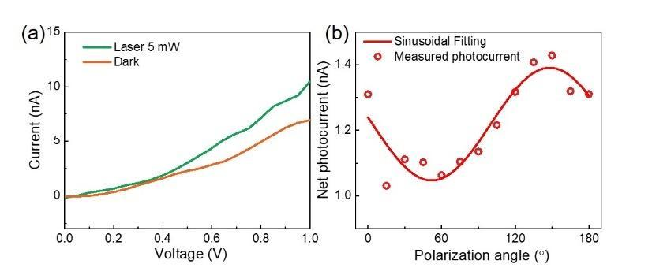

*Yau Figure 8 (p. 8): (a) I–V curves under dark conditions and with a 5 mW laser irradiation. (b) Polarization-angle dependence. The text states a photocurrent maximum at 150°. Point values were not digitized.*

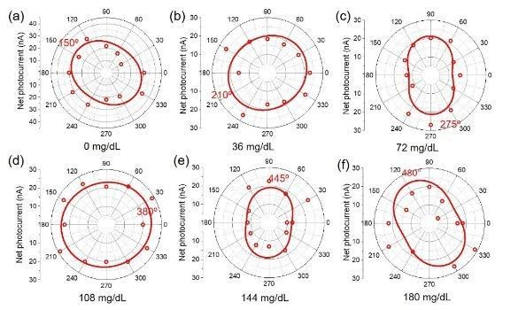

*Yau Figure 10 (p. 9): Angular-dependent photocurrent for deionized water and glucose solutions from 36 mg/dL to 180 mg/dL.*

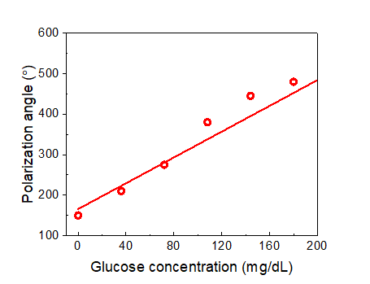

*Yau Figure 11 (p. 10): Polarization angle vs glucose concentration. The text reports a detection sensitivity of 1.59° (mg/dL)⁻¹. Points were not digitized.*

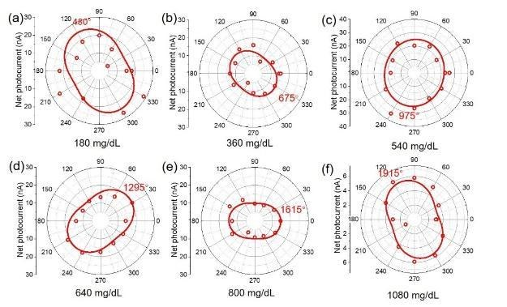

*Yau Figure 12 (p. 11): Polarization-angle dependence for glucose concentrations from 180 mg/dL to 1080 mg/dL.*

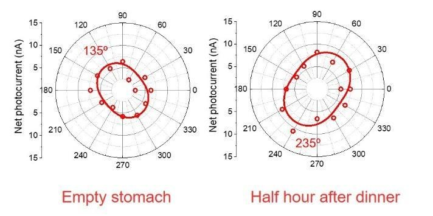

*Yau Figure 21 (p. 16): Light reflected from the author’s fingers. Printed labels: “Empty stomach” 135° and “Half hour after dinner” 235°. Laboratory self-test, not a clinical study.*


*Yau Figure 22 (p. 17): Implementation of the quick diagnostic kit for glucose.*

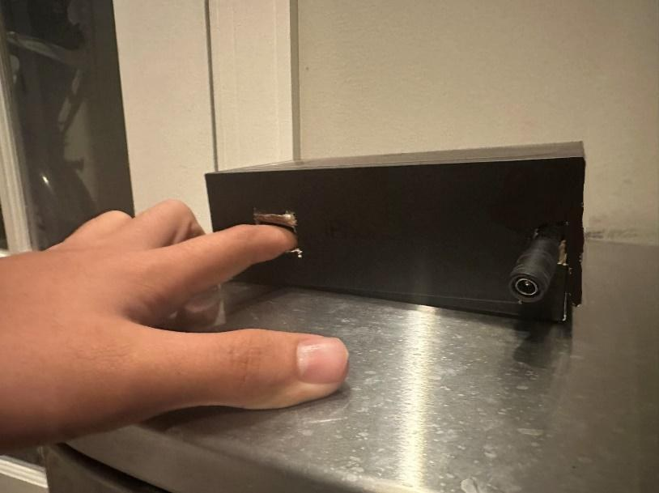

*Yau Figure 23 (p. 17): Demonstration of glucose measurement by the quick diagnostic kit. Laboratory self-test photograph.*


## Publications

1. M. B. Kopp, "Flexible nanomaterial sensors for non-invasive health monitoring," *Applied and Computational Engineering*, vol. 72, pp. 45–58, 2024. [doi:10.54254/2755-2721/72/20240981](https://doi.org/10.54254/2755-2721/72/20240981)

2. M. B. Kopp, "Next-generation polarimetric biosensors: machine learning–driven GeSe photodetectors for noninvasive glucose monitoring," *Biosensors and Bioelectronics: X*, vol. 28, art. 100725, 2025 (sole author, open access). [doi:10.1016/j.biosx.2025.100725](https://doi.org/10.1016/j.biosx.2025.100725)

3. M. B. Kopp, "Exploiting In-Plane Anisotropy of 2D GeSe for Polarizer-Free Chiroptical Biosensing: Machine Learning-Enhanced Wearable Glycemic Diagnostics." *(in preparation)*

## Awards

- **S.T. Yau High School Science Award** — Bronze Medal, Physics (North America), 2024
- **NJSHS National Symposium** — 3rd Place Poster Award (Dept. of Defense), 2024

## Tools & Technologies

- **Simulation:** COMSOL Multiphysics (optical modeling)
- **Data Analysis:** Python, MATLAB
- **Fabrication:** Nanomaterial synthesis, flexible substrate processing
- **ML Frameworks:** scikit-learn, custom calibration pipelines

## How to reproduce

The Yau report plots polarization angle vs concentration (Figures 11 and 13) but does not print a calibration-point table, so the 1.59° (mg/dL)⁻¹ slope cannot be refit from the packaged CSVs, and no R² is stated in that report.

What can be checked from the packaged CSVs is the arithmetic stated in the report:

```bash
python src/reproduce_yau_results.py
```

That script loads `data/yau-2024-stated-results.csv`, `data/yau-2024-methods-parameters.csv`, and `data/yau-2024-figure21-printed-angle-labels.csv`. It confirms that 100 / 1.59 rounds to the stated 62.9 mg/dL, that the 135° and 235° labels on Figure 21 differ by the stated 100°, that 658 nm corresponds to the stated 1.88 eV, and that an external quantum efficiency of 0.028% follows from the stated 0.15 mA/W at 658 nm.

CSV files in `data/` quote only numbers that appear in the manuscripts’ text or tables (or, for Figure 21, angle labels printed on the figure). Header comments name the source, section or figure, and page. See `data/NOTES-plot-only-values.md`.

## Repository Structure

```
gese-glucose-biosensor/
├── data/               # Numbers stated in the Yau report and in the ACE / B&B:X papers
├── figures/            # Site photographs, plus figures/paper/ from the Yau report
├── src/                # Existing utilities, plus reproduce_yau_results.py
├── README.md
├── requirements.txt
└── LICENSE
```

## License

This project is licensed under the MIT License. See [LICENSE](LICENSE) for details.

## Contact

**Maximilian Kopp** — [maxkopp2007@gmail.com](mailto:maxkopp2007@gmail.com) | [maxkopptech.com](https://www.maxkopptech.com) | [ORCID](https://orcid.org/0009-0008-6431-8137) | [Google Scholar](https://scholar.google.com/citations?user=TrKuDMsAAAAJ) | [LinkedIn](https://www.linkedin.com/in/maxkopp)
